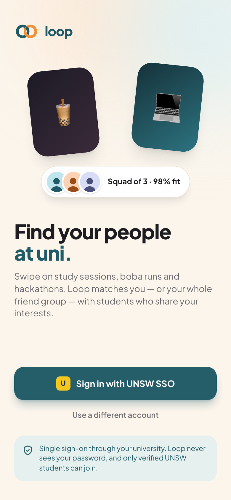
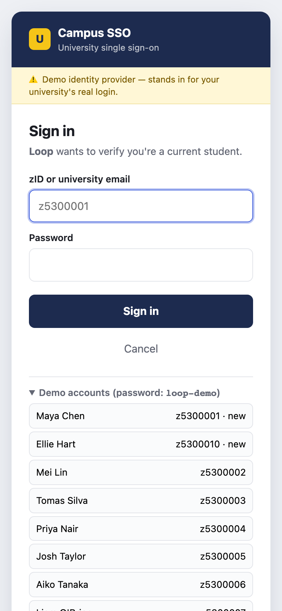
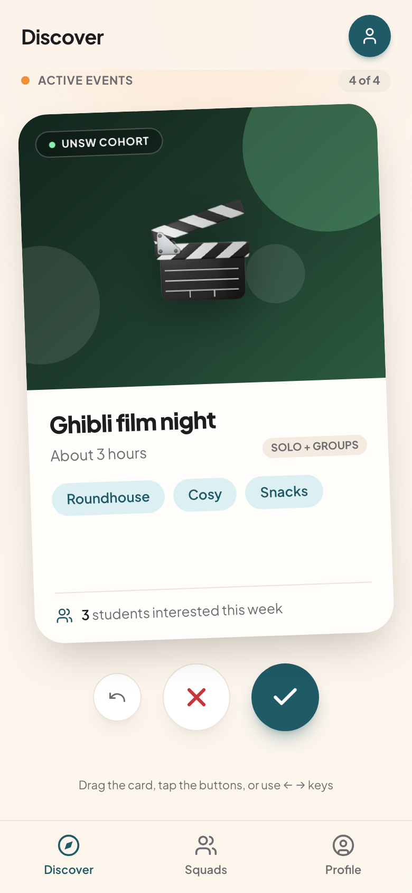
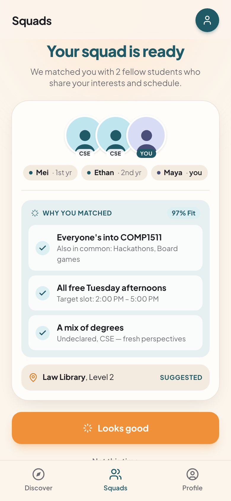
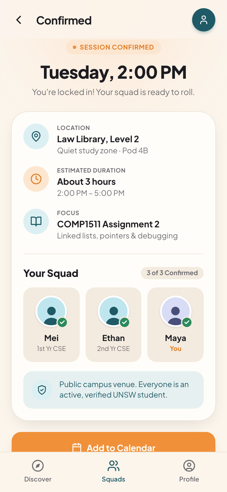
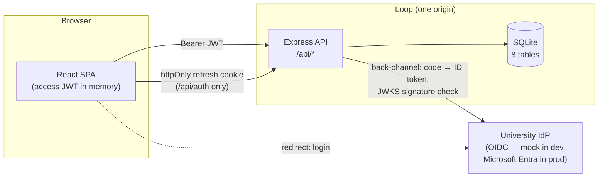
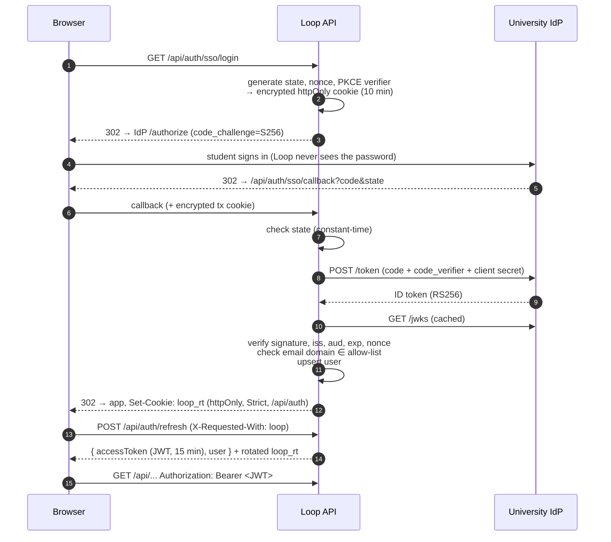
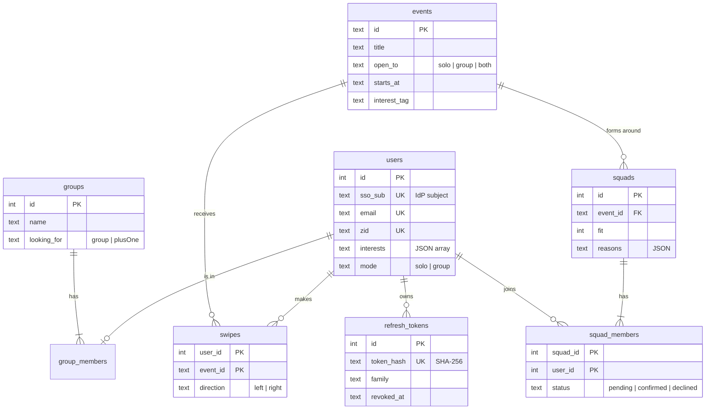

# 🔁 Loop — find your people at uni

Loop is a swipe-to-join app for university students. You swipe on things to do (a COMP1511 study sprint, a midnight boba run, a hackathon) and Loop puts you in a small **squad** with students who swiped the same way and share your interests.

You can sign up **solo**, or **as a friend group** that's looking for **another group** or just **one more friend**.

Students sign in with **university single sign-on** (OpenID Connect). The API uses **short-lived JWTs** with **rotating refresh tokens**, and only university email domains are allowed in.

| Sign in | University SSO | Discover | Squad matched | Confirmed |
|---|---|---|---|---|
|  |  |  |  |  |

---

## Quick start

Requires **Node.js ≥ 22.5** (it uses the built-in `node:sqlite`, so no database server to install).

```bash
npm install
npm run setup     # writes server/.env with random secrets, creates + seeds the SQLite DB
npm run dev       # mock SSO :4001 · API :4000 · web :5173
```

Open **http://localhost:5173** → **Sign in with UNSW SSO**.

### Demo script (≈2 minutes)

1. **Sign in** as **Maya Chen** (`z5300001`, password `loop-demo`). She's a new user, so Loop creates her account on first login from the SSO claims.
2. **Profile:** pick interests such as *COMP1511, Hackathons, Board games*.
3. **Discover:** swipe right on *COMP1511 study sprint*. The matcher puts her with **Mei and Ethan**, the students with the most shared interests, and explains why (fit %, shared interests, schedule).
4. **Looks good** confirms the squad. **Add to Calendar** downloads a real `.ics` file.
5. **Profile → As a group:** add `z5300008` (Sofia) by zID. Try `z5300010` too: Ellie has never signed in, so Loop refuses with a clear error.
6. Swipe right as a group. You get matched with another seeded group (*Kingsford Crew* or *Climb Club*).
7. **Sign out.** This ends the session in Loop *and* at the IdP (single sign-out). Then try **Jamie Park**, who is from another university and gets rejected.
8. **Reload the page** at any point while signed in: the session survives through the httpOnly refresh cookie, even though the access token only lives in memory.

All demo accounts are listed on the mock SSO page. To reset the data: `npm run db:reset -w server`.

---

## Architecture



| Folder | What |
|---|---|
| [`web/`](web) | React 19 + TypeScript + Tailwind v4 (Vite). Mobile-first; shows a phone frame on desktop. |
| [`server/src/auth/`](server/src/auth) | OIDC client, JWT access tokens, refresh-token rotation, auth middleware |
| [`server/src/services/`](server/src/services) | Users & groups, events/deck, **matching engine** |
| [`server/src/db/`](server/src/db) | `schema.sql`, connection, seed |
| [`server/src/mock-idp/`](server/src/mock-idp) | A small but spec-shaped OIDC provider standing in for university SSO |
| [`server/test/`](server/test) | End-to-end tests that drive the real redirect flow |

In dev, Vite proxies `/api` to the API, so the browser only ever talks to **one origin**. In production the Express server serves the built SPA itself. Either way there's no CORS to configure, and cookies stay first-party.

---

## Authentication flow



## Security concepts implemented

| Concept | Where / how |
|---|---|
| **SSO via OpenID Connect** | Authorization Code flow with discovery, built only on standards ([`oidc.ts`](server/src/auth/oidc.ts)). Swap in a real IdP by changing env vars. |
| **PKCE (S256)** | Stops an intercepted authorization code from being used. The mock IdP *requires* it. |
| **`state` + `nonce`** | `state` blocks login CSRF and is compared in constant time. `nonce` binds the ID token to this login attempt. |
| **ID-token verification** | RS256 signature checked against the IdP's JWKS; `iss`, `aud`, `exp`, `nonce` validated; algorithm pinned. |
| **Stateless login transaction** | state/nonce/verifier are stored in an **encrypted** (A256GCM JWE), httpOnly, 10-minute cookie, so there's no server session store. |
| **Student-only access** | `ALLOWED_EMAIL_DOMAINS` allow-list: authenticated by the IdP isn't enough, you must be a UNSW student. |
| **JWT access tokens** | HS256, 15 min, `iss`/`aud`/`jti`, algorithm pinned (rejects `alg: none` and tampered tokens). Kept **in memory only**, never in localStorage. |
| **Refresh-token rotation + reuse detection** | Opaque random tokens, stored as **SHA-256 hashes**. Every refresh issues a new one. Replaying an old token revokes the whole token family, logging out both the attacker and the victim. |
| **Cookie hardening** | `HttpOnly`, `Secure` (prod), `SameSite=Strict`, `Path=/api/auth`: the long-lived token never reaches JS or other endpoints. |
| **CSRF defence** | Cookie-authenticated endpoints require an `X-Requested-With` header, which a cross-site request can't send without a CORS preflight that the API never approves. Everything else uses Bearer tokens. |
| **Single sign-out** | Logout revokes the refresh family, then redirects to the IdP's `end_session_endpoint`. |
| **Open-redirect protection** | `returnTo` must be a same-app relative path. The IdP only redirects to registered URIs. |
| **Input validation** | Every body/param goes through a `zod` schema. `strictObject` rejects unknown fields, which blocks mass-assignment such as `is_demo`. |
| **SQL injection** | Only parameterised statements are used. |
| **Authorisation** | You can only see or act on squads you're in. Non-members get `404`, not `403`, so a squad's existence isn't revealed. |
| **Security headers** | Helmet: strict CSP (`script-src 'self'`, `frame-ancestors 'none'`), HSTS, nosniff, no-referrer. |
| **Rate limiting** | 30 req/min on `/api/auth`, 300 req/min on the API. |
| **Secrets** | `npm run setup` generates random secrets into a git-ignored `.env`. Config is validated at boot, and the server refuses to start with a weak `JWT_SECRET`. |
| **No info leaks** | Unknown errors return a generic `500`; details only go to server logs. |

### Using real UNSW SSO

UNSW runs on Microsoft 365, so production would register Loop as an app in **Microsoft Entra ID**. Once that app registration exists, the only change is configuration:

```env
OIDC_ISSUER=https://login.microsoftonline.com/<tenant-id>/v2.0
OIDC_CLIENT_ID=<application (client) id>
OIDC_CLIENT_SECRET=<client secret>
APP_ORIGIN=https://loop.example.com     # redirect URI = APP_ORIGIN/api/auth/sso/callback
ALLOWED_EMAIL_DOMAINS=ad.unsw.edu.au,student.unsw.edu.au,unsw.edu.au
```

The client already falls back to Entra's `preferred_username` claim when `email` isn't released.

---

## Database

Eight small tables in SQLite ([`schema.sql`](server/src/db/schema.sql)), with foreign keys enforced and WAL mode on.



## Matching

When you swipe right, [`squads.ts`](server/src/services/squads.ts) looks at everyone else who swiped right on that event and scores them by **interests shared with you (or your whole group)**, plus a small bonus for being in the same year:

- **Solo:** you + the 2 best-scoring students
- **Group → +1 friend:** your group + the best single student
- **Group → another group:** your group + the best-fitting other group (falls back to 2 students)

The squad stores a **fit %** and three generated **"why you matched"** reasons. Seeded demo students accept straight away so the demo feels alive; real students start as *pending* until they confirm.

## API

All routes except `/api/auth/*` require `Authorization: Bearer <access token>`.

| Method | Path | |
|---|---|---|
| GET | `/api/auth/sso/login` | Start SSO (optional `?prompt=login`) |
| GET | `/api/auth/sso/callback` | OIDC redirect URI |
| POST | `/api/auth/refresh` | Rotate refresh cookie → `{ accessToken, user }` |
| POST | `/api/auth/logout` | Revoke session → `{ logoutUrl }` for IdP sign-out |
| GET / PATCH | `/api/me` | Profile: name, degree, year, interests, mode |
| PATCH | `/api/me/group` | Group name, `lookingFor` |
| POST / DELETE | `/api/me/group/members[/:id]` | Add a friend by zID / remove |
| GET | `/api/events/deck` | Events you haven't swiped on, filtered by mode |
| POST | `/api/swipes` | `{ eventId, direction }` → `{ matched, squad }` |
| POST | `/api/swipes/undo` | Undo last swipe (withdraws its pending squad) |
| GET | `/api/squads` | Your squads |
| POST | `/api/squads/:id/confirm` · `/decline` | Respond to a squad |

## Tests

```bash
npm test
```

16 end-to-end tests start the real IdP and API against a temporary database, then run the full browser redirect flow over HTTP. They cover:

- the PKCE/state/nonce parameters
- a successful login
- a wrong password
- a non-UNSW student being rejected
- a tampered `state`
- authorization-code replay
- refresh without the CSRF header
- refresh-token rotation and reuse detection
- forged and `alg: none` JWTs
- logout
- solo and group matching
- undo
- input validation
- access to squads you're not in

## Production

```bash
npm run build
APP_ORIGIN=http://localhost:4000 npm start   # one server: SPA + API (+ mock IdP)
```

## Known limitations

- The mock IdP keeps codes and sessions in memory and uses one shared demo password. It exists only for dev and demos.
- SQLite fits a single server. For multiple instances, move to Postgres; the SQL is plain and portable.
- There are no notifications yet, so other real students only see a pending squad the next time they open the app.
- Events are seeded; an admin or society tool to create them is the obvious next step.
